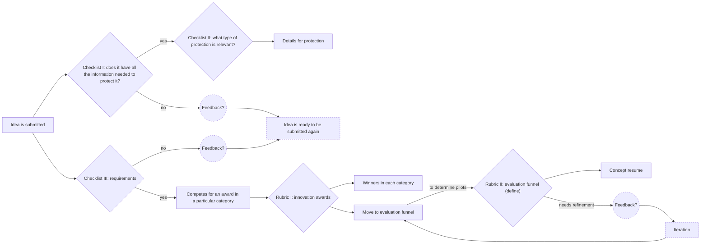

# How ideas were designed to move

Before we chose a tool, we set up an initial flow a submitted idea would follow, so the tool could support it. I drew the original diagram; this is a redraw without internal names or the open questions that sat beside it.

Steps with a question mark or a dashed outline were drawn that way in the original.
